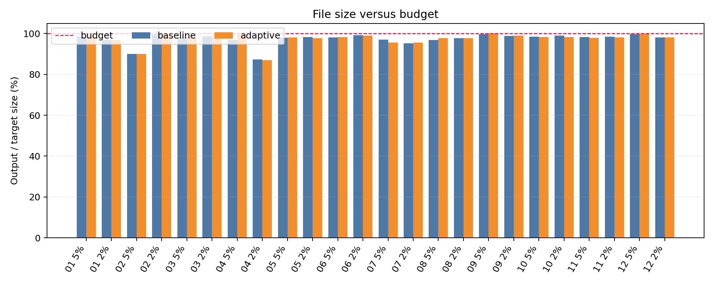
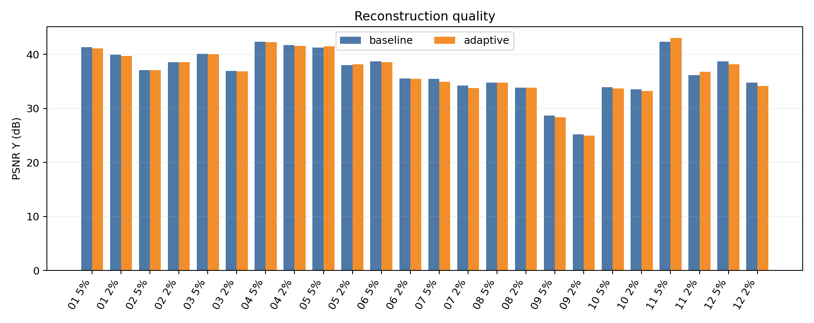
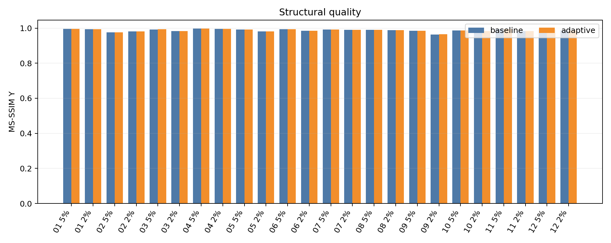
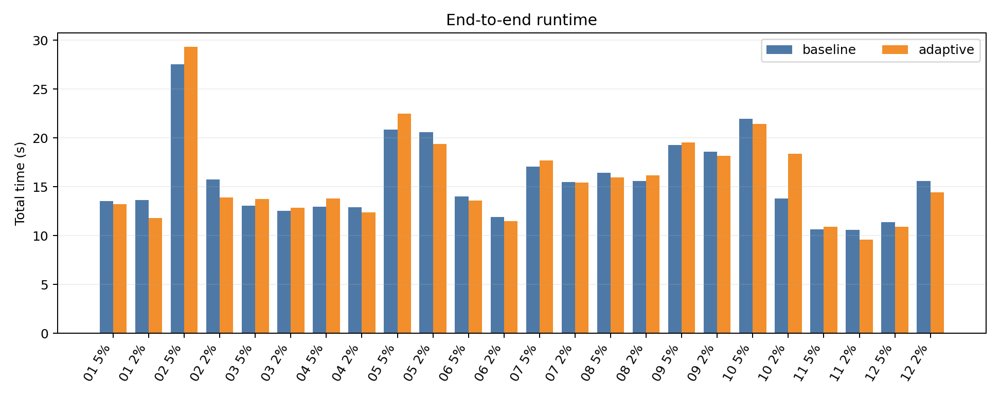
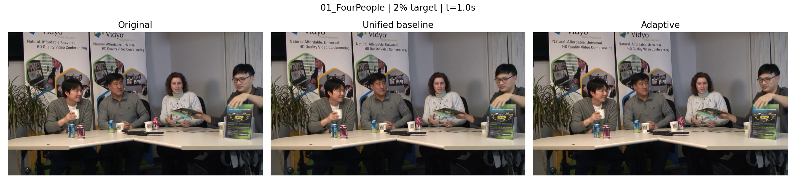
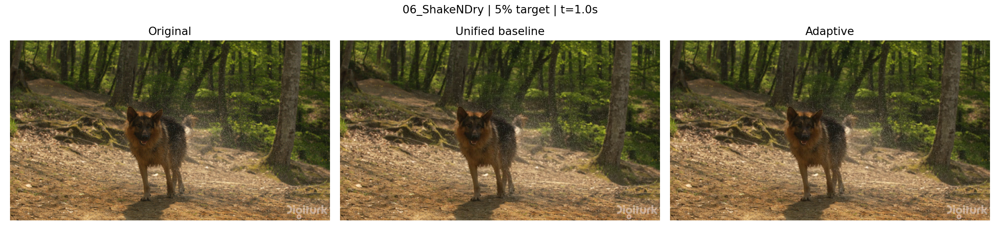
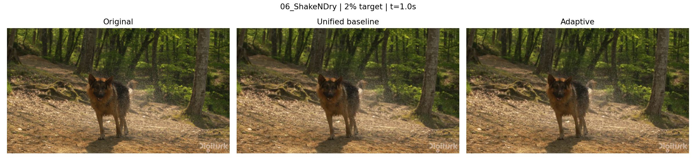
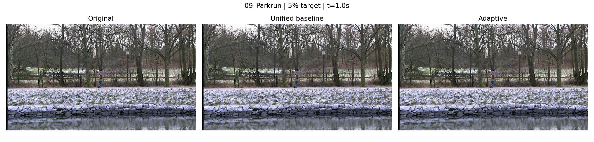
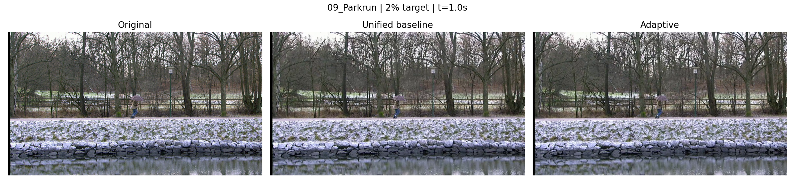

# CS5185 实验结果与 PPT 分析素材

本报告从 `results/` 中实际编码与评估日志自动生成。图像为同时间戳画面，质量指标基于 Y 通道。

## 汇总

已完成 48 个编码任务，24 组基线/自适应配对；目标为 12 视频 × 2 档 × 2 模式，共 48 个编码任务。

| 视频 | 目标 | 基线大小/目标 | 自适应大小/目标 | ΔPSNR (dB) | ΔMS-SSIM | 自适应决策 |
|---|---:|---:|---:|---:|---:|---|
| 01_FourPeople | 5% | 98.67% | 99.00% | -0.17 | +0.0001 | AQ 2, strength 1.2 |
| 01_FourPeople | 2% | 96.80% | 96.87% | -0.22 | +0.0000 | AQ 2, strength 1.2 |
| 02_Beauty | 5% | 89.96% | 89.96% | +0.00 | +0.0000 | AQ 1, strength 1.0 |
| 02_Beauty | 2% | 99.45% | 99.45% | +0.00 | +0.0000 | AQ 1, strength 1.0 |
| 03_Bosphorus | 5% | 98.32% | 98.47% | -0.11 | +0.0001 | AQ 2, strength 1.2 |
| 03_Bosphorus | 2% | 98.66% | 98.90% | -0.08 | +0.0003 | AQ 2, strength 1.2 |
| 04_HoneyBee | 5% | 96.86% | 99.58% | -0.06 | +0.0000 | AQ 2, strength 1.2 |
| 04_HoneyBee | 2% | 87.28% | 86.95% | -0.12 | -0.0000 | AQ 2, strength 1.2 |
| 05_Jockey | 5% | 97.84% | 98.16% | +0.18 | -0.0000 | AQ 2, strength 0.8 |
| 05_Jockey | 2% | 98.29% | 97.82% | +0.18 | -0.0005 | AQ 2, strength 0.8 |
| 06_ShakeNDry | 5% | 98.12% | 98.26% | -0.15 | +0.0001 | AQ 2, strength 1.2 |
| 06_ShakeNDry | 2% | 99.11% | 98.97% | -0.13 | +0.0003 | AQ 2, strength 1.2 |
| 07_Mobcal | 5% | 97.05% | 95.51% | -0.51 | +0.0000 | AQ 2, strength 1.2 |
| 07_Mobcal | 2% | 95.23% | 95.54% | -0.46 | -0.0000 | AQ 2, strength 1.2 |
| 08_Shields | 5% | 96.91% | 97.81% | -0.07 | +0.0000 | AQ 2, strength 0.8 |
| 08_Shields | 2% | 97.70% | 97.75% | -0.04 | -0.0000 | AQ 2, strength 0.8 |
| 09_Parkrun | 5% | 99.77% | 100.00% | -0.26 | +0.0011 | AQ 2, strength 0.8 |
| 09_Parkrun | 2% | 98.74% | 99.09% | -0.20 | +0.0028 | AQ 2, strength 0.8 |
| 10_Stockholm | 5% | 98.49% | 98.34% | -0.25 | +0.0003 | AQ 2, strength 1.2 |
| 10_Stockholm | 2% | 99.04% | 98.22% | -0.26 | +0.0001 | AQ 2, strength 1.2 |
| 11_Sintel | 5% | 98.36% | 97.99% | +0.63 | -0.0001 | AQ 2, strength 0.8 |
| 11_Sintel | 2% | 98.55% | 98.08% | +0.61 | +0.0004 | AQ 2, strength 0.8 |
| 12_ControlledBurn | 5% | 99.71% | 99.88% | -0.55 | +0.0001 | AQ 2, strength 1.2 |
| 12_ControlledBurn | 2% | 98.16% | 98.18% | -0.64 | -0.0000 | AQ 2, strength 1.2 |

## 适合 PPT 的结论

1. 完整性：48/48 个已完成输出通过解码、时长、帧数、分辨率和帧率检查；48/48 个输出在精确字节预算内。
2. 内容决策：在 22 组参数真正改变的配对中，自适应方案的 Y-PSNR 提高了 4 组；这说明规则并非对所有内容都有同样收益，应结合画面对照解释。
3. 大小控制：两方案使用相同目标字节、两遍编码和反馈公式；文件大小图中的 100% 虚线就是硬预算。PSNR 与 MS-SSIM 请与该图一起看，避免把更大的文件误判为纯粹的编码优势。
4. 耗时：总时间包含 metadata、特征分析、所有编码轮次、解码检查、质量评估和日志写入；运行时间图可说明自适应决策的实际成本。

## 三个可讲的具体案例

- **09_Parkrun（保留测试集）**：5% 档的 ΔPSNR 为 -0.26 dB、ΔMS-SSIM 为 +0.0011；2% 档分别为 -0.20 dB、+0.0028。规则选择 AQ mode 2 / strength 0.8。可把 2% 三栏画面与特征曲线并排讲，说明结构指标改善与像素误差指标并不总一致。该案例不能声称全面画质提升。
- **05_Jockey（保留测试集）**：两档 PSNR 均约 +0.18 dB，但 MS-SSIM 略降。适合解释快速变化内容触发低 AQ strength 后的指标取舍，并在原片与压缩结果的同帧局部放大图中核对主观观感。
- **11_Sintel（补充样例）**：5% 与 2% 档 PSNR 分别约 +0.63、+0.61 dB；2% 档 MS-SSIM 也约 +0.0004。可作确有收益的补充例，但该视频不在指定保留测试集，汇报时必须标明。
- **02_Beauty（回退案例）**：特征未触发参数切换，两组结果完全相同。它证明规则有明确回退行为，也提醒展示时不要把相同输出计入自适应增益。

推荐 PPT 主线：流程图 → `09_Parkrun_features.png` 决策曲线 → `size_budget.png` → `quality_psnr.png` 与 `quality_msssim.png` → `compare_09_Parkrun_2pct.png` → 局限。三视频六档汇总可从表格选 `01_FourPeople`、`06_ShakeNDry`、`09_Parkrun`。

## 图表

## 方法和局限

基线固定 preset=medium、AQ mode=1、strength=1.0；自适应只根据帧差 P90 和平均边缘比例选择 AQ。两方案均用 libx264 双遍平均码率，目标字节相同。规则阈值为预设启发式，不能保证每个视频都优于基线。
PSNR(Y) 对全部对应帧累计平方误差后计算；MS-SSIM(Y) 使用 pytorch-msssim 1.0.0、data_range=255、默认 5 个尺度，在每 30 帧取一帧并作算术平均。整片其余帧仍参与 PSNR 与完整性检查。
报告中显示的实验时间与数值仅对当前硬件和环境有效。每条任务的输入/输出 SHA-256、FFmpeg 命令、逐轮决策、失败信息与精确数值见 `results/*.json`。
