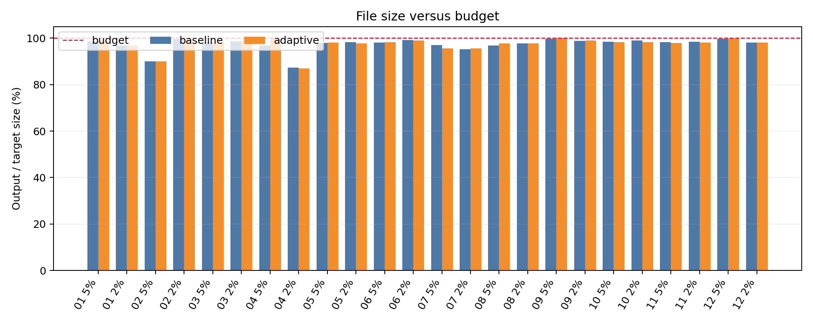
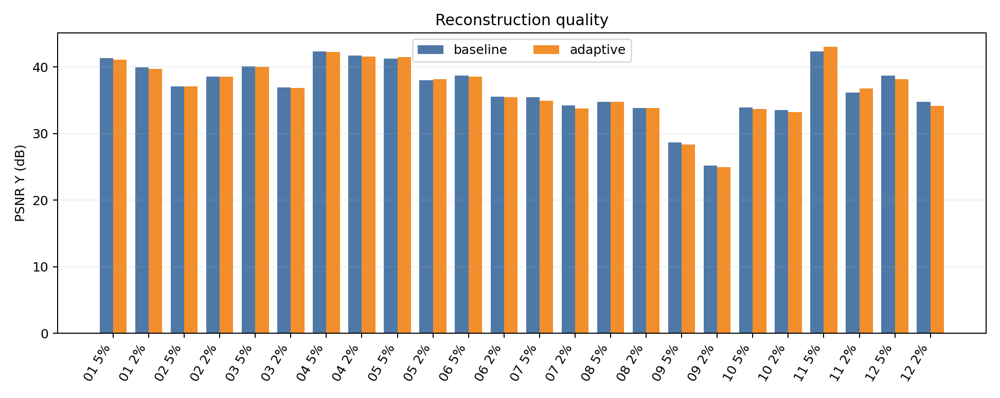
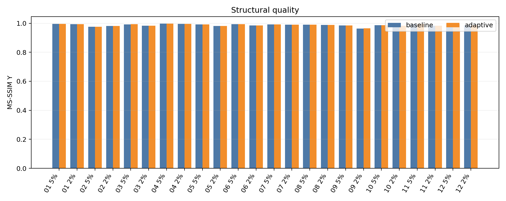
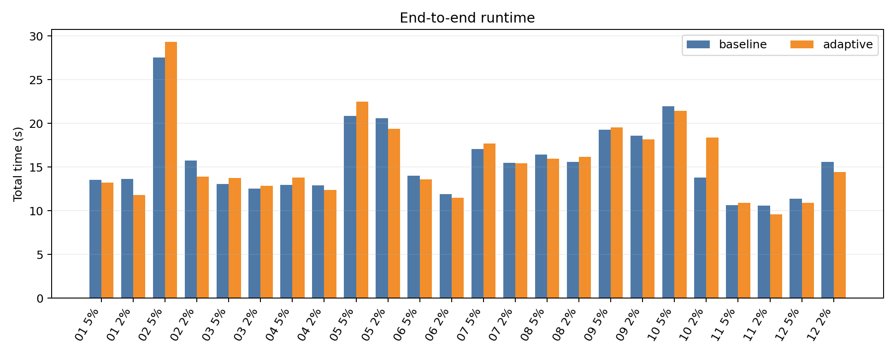
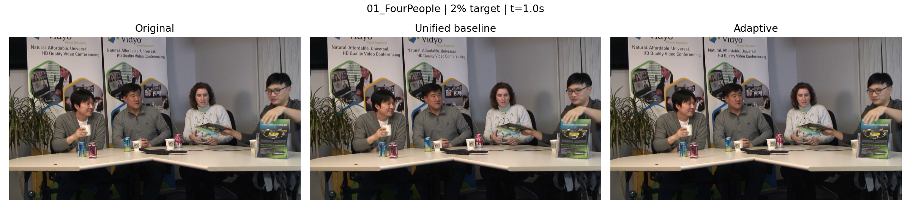
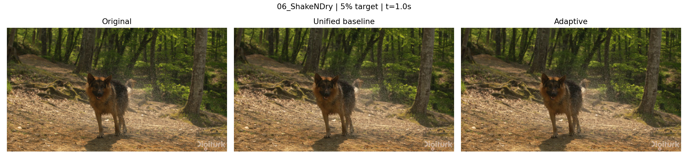
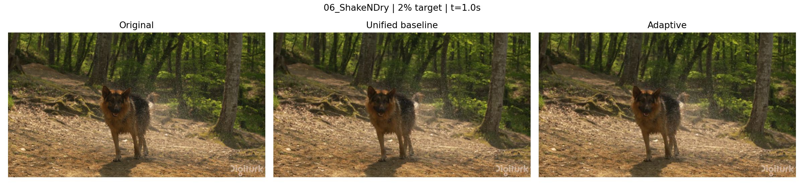
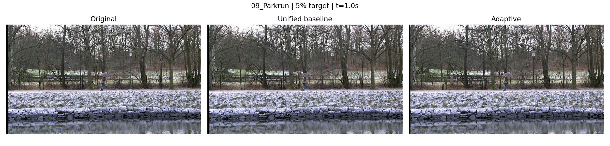
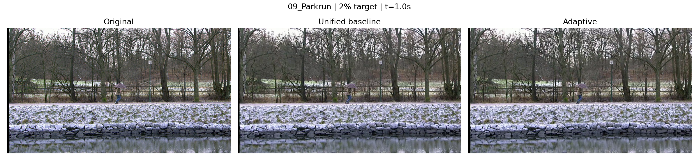

# CS5185 实验分析与 PPT 设计参考

本稿供中文理解和制作汇报使用。全部数值来自已完成的 `results/*.json` 和 `results/summary.csv`，不是预期效果。英文数据报告保存在 `analysis_en.md`；重新运行 `analyze.py` 会更新英文报告和图表，不会覆盖本稿。

## 1. 题目要求与实际完成内容

题目要求对 12 段无音轨视频分别压缩到原始文件大小的 **5% 和 2%**，使用 FFmpeg 的 x264 编码器，保持视频时长与内容完整。系统需具备内容分析、参数决策、编码、结果检查和必要时的反馈调整，并与统一参数基线比较画质和耗时。

实际实现了 12 × 2 × 2＝**48 次正式编码**（每段视频、每档目标均有基线和自适应输出）。系统按原始字节数计算精确预算；逐帧提取灰度帧差和边缘密度；根据运动强度与细节复杂度选择 AQ 参数；用 FFmpeg/libx264 双遍编码；超预算时从原片重新编码，最多三次；最后检查解码、时长、帧数、分辨率、帧率，并计算 PSNR(Y)、MS-SSIM(Y) 和运行时间。

统一基线固定 `preset=medium, aq-mode=1, aq-strength=1.0`。自适应方案只改变 AQ mode/strength，其他关键编码条件保持一致。最终 MP4 在 `result/5_percent/` 与 `result/2_percent/`，两类各 24 个；中间日志和特征曲线在 `results/`。

## 2. 可以直接用于汇报的结论

1. **功能与大小控制达标：**48/48 个最终视频均不超过精确字节预算；48/48 个通过完整解码及视频时长、帧数、分辨率和帧率检查。其中 19 次编码任务需要第二轮或第三轮调整，最多三轮。
2. **当前自适应规则并非普遍提升画质：**24 组配对中，22 组实际改变 AQ 参数；这 22 组只有 4 组的 PSNR(Y) 高于基线。因而不能声称“自适应方案总体优于基线”。系统闭环有效，但参数决策规则还有明显改进空间。
3. **不同指标会给出不同结论：**例如 `Parkrun` 两档的 MS-SSIM 均上升，PSNR 却下降。汇报时应同时展示预算占比、两项指标与同一时刻画面，避免单看一个有利数值。
4. **对照相对公平：**两方案使用相同目标字节、双遍码率控制、preset、分辨率、帧率和像素格式。实际生成字节数仍有细小差异，评价画质时需要一并考虑。

## 3. 全部视频的配对结果

“大小/预算”是实际 MP4 字节数除以目标字节数；**低于或等于 100% 即达标**。Δ＝自适应减基线，正数表示对应指标上升。`+0.0000` 或 `-0.0000` 是四舍五入后的近零差异，不应当作显著提升。

| 视频 | 目标 | 基线大小/预算 | 自适应大小/预算 | ΔPSNR(Y), dB | ΔMS-SSIM(Y) | 自适应 AQ |
|---|---:|---:|---:|---:|---:|---|
| 01_FourPeople | 5% | 98.67% | 99.00% | -0.17 | +0.0001 | mode 2 / 1.2 |
| 01_FourPeople | 2% | 96.80% | 96.87% | -0.22 | +0.0000 | mode 2 / 1.2 |
| 02_Beauty | 5% | 89.96% | 89.96% | +0.00 | +0.0000 | mode 1 / 1.0 |
| 02_Beauty | 2% | 99.45% | 99.45% | +0.00 | +0.0000 | mode 1 / 1.0 |
| 03_Bosphorus | 5% | 98.32% | 98.47% | -0.11 | +0.0001 | mode 2 / 1.2 |
| 03_Bosphorus | 2% | 98.66% | 98.90% | -0.08 | +0.0003 | mode 2 / 1.2 |
| 04_HoneyBee | 5% | 96.86% | 99.58% | -0.06 | +0.0000 | mode 2 / 1.2 |
| 04_HoneyBee | 2% | 87.28% | 86.95% | -0.12 | -0.0000 | mode 2 / 1.2 |
| 05_Jockey | 5% | 97.84% | 98.16% | +0.18 | -0.0000 | mode 2 / 0.8 |
| 05_Jockey | 2% | 98.29% | 97.82% | +0.18 | -0.0005 | mode 2 / 0.8 |
| 06_ShakeNDry | 5% | 98.12% | 98.26% | -0.15 | +0.0001 | mode 2 / 1.2 |
| 06_ShakeNDry | 2% | 99.11% | 98.97% | -0.13 | +0.0003 | mode 2 / 1.2 |
| 07_Mobcal | 5% | 97.05% | 95.51% | -0.51 | +0.0000 | mode 2 / 1.2 |
| 07_Mobcal | 2% | 95.23% | 95.54% | -0.46 | -0.0000 | mode 2 / 1.2 |
| 08_Shields | 5% | 96.91% | 97.81% | -0.07 | +0.0000 | mode 2 / 0.8 |
| 08_Shields | 2% | 97.70% | 97.75% | -0.04 | -0.0000 | mode 2 / 0.8 |
| 09_Parkrun | 5% | 99.77% | 100.00% | -0.26 | +0.0011 | mode 2 / 0.8 |
| 09_Parkrun | 2% | 98.74% | 99.09% | -0.20 | +0.0028 | mode 2 / 0.8 |
| 10_Stockholm | 5% | 98.49% | 98.34% | -0.25 | +0.0003 | mode 2 / 1.2 |
| 10_Stockholm | 2% | 99.04% | 98.22% | -0.26 | +0.0001 | mode 2 / 1.2 |
| 11_Sintel | 5% | 98.36% | 97.99% | +0.63 | -0.0001 | mode 2 / 0.8 |
| 11_Sintel | 2% | 98.55% | 98.08% | +0.61 | +0.0004 | mode 2 / 0.8 |
| 12_ControlledBurn | 5% | 99.71% | 99.88% | -0.55 | +0.0001 | mode 2 / 1.2 |
| 12_ControlledBurn | 2% | 98.16% | 98.18% | -0.64 | -0.0000 | mode 2 / 1.2 |

## 4. 重点案例：怎么讲“检测—决策—结果”

### Parkrun：指标出现分歧的保留测试案例

帧差规则触发 `aq-mode=2, aq-strength=0.8`。在 2% 预算下，PSNR 比基线低 0.20 dB，而 MS-SSIM 高 0.0028；5% 预算下分别为 -0.26 dB 和 +0.0011。可展示 `results/09_Parkrun_features.png`、下方同帧三栏图，以及两档汇总表。讲法是：检测到较强时间变化，采用预设 AQ 调整，但改善了结构指标的同时损失了像素误差指标；必须靠局部画面及播放判断真实观感。不要说成全面画质提升。

### Jockey：PSNR 略有收益，但结构指标未同步提升

它也是保留测试视频。两档 PSNR 均约提高 0.18 dB，MS-SSIM 却略降。这个案例适合说明参数改变对不同质量标准的影响。若放进 PPT，应另外从原片、基线和自适应视频截取同一时间点局部放大画面。

### Sintel 与 Beauty：收益和回退的边界

`Sintel` 在 5% 与 2% 的 PSNR 分别提高约 0.63、0.61 dB，2% 的 MS-SSIM 也提高约 0.0004；但它属于补充样例，不应冒充保留测试集。`Beauty` 没有触发 AQ 参数切换，结果与基线相同；它能说明规则具备明确回退行为，不能计作自适应增益。

## 5. PPT 图表与建议页序

建议 5–6 页、约 5 分钟：①任务与双预算目标；②完整闭环和参数规则；③ `Parkrun` 特征曲线与具体决策；④大小达标和耗时；⑤ PSNR、MS-SSIM 及同帧画面对照；⑥结论和不足。至少三段视频、两档预算的汇总可选 `FourPeople`、`ShakeNDry`、`Parkrun`。演示一个案例的因果链即可，完整 24 组配对表放报告或备份页。

同帧三栏图（原片、统一基线、自适应）如下；每段视频同时提供 5% 和 2% 档。

## 6. 方法不足与使用边界

- 决策只依据帧差和边缘比例，阈值为固定启发式；没有系统搜索最优参数，也没有区分摄像机运动、噪声和真实物体运动。编码设置按整段视频选择，不能在片段内部随内容变化。
- 22 组参数切换中只有 4 组 PSNR 提高，说明当前规则的普遍性较弱。后续可在开发集比较多个候选 AQ 参数，并以保留测试集检验是否泛化。
- PSNR(Y) 使用全部对应帧的累计平方误差；MS-SSIM(Y) 使用 `pytorch-msssim 1.0.0`、`data_range=255`、默认五尺度，每 30 帧抽一帧后取算术平均，并非全帧时间平均。
- 同帧截图可辅助判断模糊、块效应和细节损失，不能单独证明运动流畅度；汇报前应播放最终 MP4 并做人工观察。图表不是盲测主观评分，运行时间也只适用于本机环境。

完整精度、每轮 FFmpeg 命令、哈希值和参数依据见 `results/*.json`；输入视频的来源与授权信息见数据集的 `licenses/`。
